[github](https://github.com/itsnacho)

> Software developer & builder. 
> Passionate about coding, open source, and exploring new technologies.

I enjoy building cool tools, solving problems, and learning across the stack. Constantly experimenting and leveling up my skills.

<samp>python &nbsp; javascript &nbsp; typescript &nbsp; git &nbsp; linux</samp>

No third-party widgets. No stats cards that go down at 2am. Every graphic 
on this page is generated by [this repo](.github/workflows/stats.yml), pulling 
straight from the GitHub API once a day and committing only what changed.
